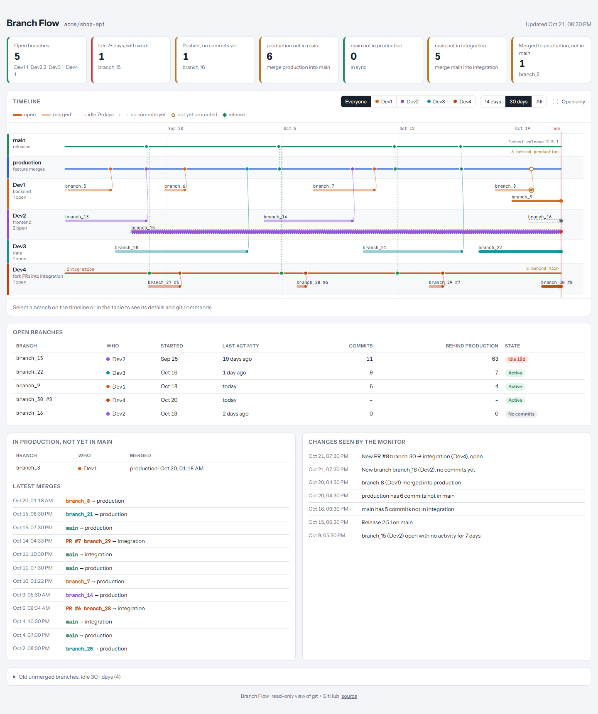
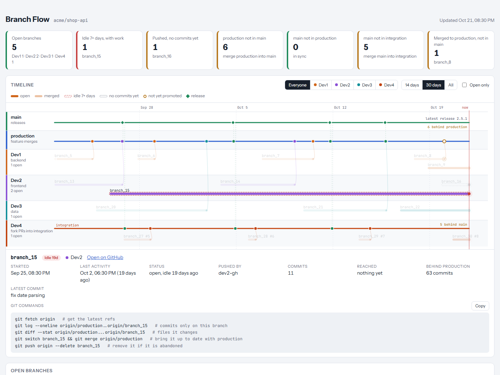

# Branch Flow

**One page that shows where every branch in your team stands:** who is working on what, what was merged where, and what is stuck between `production`, `main` and your integration branches.



**[Live demo](https://slemanawad.github.io/branch-flow/)** (made-up team: Dev1 to Dev4, `branch_1`…, PR #1…)

GitHub shows pull requests one at a time. A team lead usually wants the whole picture:

- Which branches are open right now, and whose are they?
- Which ones have gone quiet and are drifting behind?
- Was that fix merged into `production` but never promoted to `main`?
- Is the integration branch behind the latest release?

Branch Flow answers these from your own clone and the GitHub CLI. It is read-only and runs on your machine. No server, no database, no write tokens.

## What you get

| | |
|---|---|
| **Swimlane timeline** | Trunk branches on top (`main`, `production`, …), one lane per developer below. Each branch is a bar from first commit to merge, with a line into the branch it was merged into. |
| **Flow checks** | For every promotion path you define (`production → main`, `main → integration`, …), how many commits are waiting. |
| **Open branches table** | Started, last activity, commits, how far behind your base branch, and a state: *Active*, *Idle 7d*, *No commits*. |
| **Waiting to be promoted** | Branches merged into one trunk but not yet in the next. |
| **Fork PRs** | Pull requests from forks get their own bars, so outside contributors show up too. |
| **Branch details** | Click any bar: who pushed it, what it reached, PR state, and ready-to-copy git commands (see its commits, its changed files, update it, delete it). |
| **Change log** | Every run records what changed since the last one: new branches, merges, PRs, flows going out of sync. |
| **Filters** | By person, by time range, open only. Light and dark theme. |



## Is it for your team?

| Team workflow | Fit |
|---|---|
| Feature branches with a separate `production` / release / integration branch (Git Flow style) | Strong. This is what it was built for. |
| GitHub Flow: feature branches into `main` | Good. You get open, idle and drift tracking. Define just one trunk. |
| Trunk-based development: short branches, feature flags, merges several times a day | Low. There is little to track. |

It does not judge people. It shows where work is, so nobody has to ask for a status update.

## Quick start

Needs **Python 3.9+**, **git**, and the **[GitHub CLI](https://cli.github.com/)** signed in (`gh auth login`) with read access to the repository.

```bash
git clone https://github.com/SLemanAwad/branch-flow.git
cd branch-flow
cp config.example.json config.json     # then edit it, see below
python -I serve.py
```

It opens `http://localhost:8765`. Every refresh pulls the latest from GitHub (about 10 to 30 seconds on a busy repository; reused for 60 seconds).

No server wanted? `python -I collect.py` builds `index.html` once; open it in a browser.

Want to look before configuring? `python -I demo.py` builds `docs/index.html` from made-up data.

## Configuration

`config.json` is yours and never committed. A full example is in [`config.example.json`](config.example.json).

| Key | Meaning |
|---|---|
| `repo` | `owner/name` on GitHub |
| `clone` | Path to a local clone of it (the collector runs `git fetch` there; it never changes your working tree) |
| `trunks` | Long-lived branches, in display order. `"releases": true` marks the branch where release commits land. `"lane": "<person id>"` draws that trunk inside a person's lane, for example an integration branch one developer owns. |
| `base` | Branch that open branches are measured against ("behind production: 63"). Defaults to the first trunk. |
| `flows` | Promotion paths to check, `{ "from": "production", "to": "main", "hint": "…" }`. Add `"list_branches": true` to list the branches waiting on that path. |
| `people` | One lane per person. `match` holds GitHub logins and git author names (case-insensitive substrings). Anyone unmatched goes to an *Others* lane. |
| `release_pattern` | Regex on commit subjects that marks a release on the release trunk, for example `^Release\b`. |
| `ignore_pattern` | Regex for trunk commits to leave off the timeline, for example version bumps. |
| `window_days`, `stale_days`, `abandoned_days` | Timeline span, when an open branch counts as idle, and when it moves to the "old unmerged" list. |
| `port` | Port for `serve.py`. |

## How it decides

| Question | Answer |
|---|---|
| Whose branch is it? | The GitHub account that pushed it (GitHub's repository activity API). Falls back to the most common commit author. |
| Is it merged? | Its tip is reachable from a trunk. The merge date is the first commit on that trunk's first-parent history that contains it. |
| "No commits yet"? | It was pushed from a commit that was already on a trunk, and nothing has been added since. |
| Idle? | Open, and no commit or push for `stale_days`. Empty branches are counted separately, so they don't inflate the idle count. |
| Behind? | Commits on `base` that the branch doesn't have. This is drift, not a prediction of conflicts. |

## Limits

- GitHub only, for now. It uses `gh` for pull requests and branch-push history.
- GitHub keeps branch-push history for about 90 days. Older branches fall back to commit authors.
- Merges are read from git history. Squash merges and rebases that rewrite commits show up as "merged" only if the original tip is still reachable.
- It reads branches on your remote. Work that was never pushed is invisible to it, as it should be.

## Files

| File | Role |
|---|---|
| `collect.py` | Reads git and GitHub, writes `data.json`, `history.json` and `index.html` |
| `template.html` | The page. Data is embedded where `/*__DATA__*/null` sits. |
| `serve.py` | Local server that re-collects on page load |
| `demo.py` | Builds the demo page from made-up data |
| `notify-windows.ps1` | Optional: collect, then show a Windows notification when something changed (for Task Scheduler) |

## Ideas and contributions

Issues and pull requests are welcome. Useful next steps:

- Slack or Teams message when a branch goes idle or a flow goes out of sync
- Files changed on both sides, to warn about real conflicts and not just commit counts
- GitLab and Bitbucket support
- Per-person summary for one-on-ones

## License

[MIT](LICENSE)
